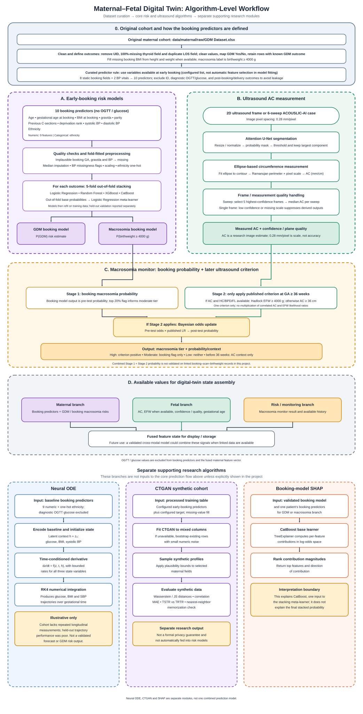

# MDT-GEN algorithm workflow

This combined diagram begins with the source cohort and feature curation, then follows the implemented prediction and measurement logic. It is intentionally not a software deployment, API, or database diagram.

## What the diagram represents

- The configured source cohort is `data/maternal/raw/GDM Dataset.xlsx`. Preprocessing drops the patient identifier, the all-missing thyroid field and a duplicate length-of-stay field; cleans labels and values; and fills missing booking BMI from height/weight when possible. The final booking predictors are a configured early-booking list (not automatically selected during model fitting): eight static fields plus two BP vitals. BMI represents height/weight; OGTT/glucose and post-booking/delivery outcomes are excluded to avoid leakage.
- The booking-risk models use nine numerical predictors—age, gestational age at booking, BMI at booking, gravida, parity, previous C-sections, deprivation rank, systolic BP and diastolic BP—plus ethnicity. OGTT/glucose measurements are excluded.
- Booking features pass project quality checks and fold-fitted imputation, scaling, BP missingness flags and ethnicity encoding. Separate GDM and macrosomia outcomes use the same five-fold out-of-fold stack: Logistic Regression, Random Forest, XGBoost and CatBoost probabilities feed a Logistic Regression meta-learner.
- The fetal path uses the ACOUSLIC-AI Attention U-Net to segment the abdomen, then fits an ellipse and estimates circumference with the Ramanujan approximation using 0.28 mm/pixel. For a sweep, it selects the five most confident frames and takes their median AC. The 0.28 mm/pixel value is image scale, not a claimed AC error or accuracy.
- The macrosomia monitor uses the booking macrosomia probability as the pre-test risk. At gestational age 36 weeks or later, it applies one published ultrasound criterion: Hadlock EFW ≥ 4000 g when AC plus HC, BPD and FL are available; otherwise AC ≥ 36 cm. When applicable, it updates odds with the published likelihood ratio. Before 36 weeks, AC is descriptive context only.
- AC comparison with the gestational-age reference median is growth context, not a cutoff. The combined two-stage probability is explicitly not validated on linked booking, scan and birthweight records in this project.
- Final state assembly collects available maternal, fetal and risk values for display/storage. Future work could explore a validated cross-modal model if linked maternal, scan and outcome data become available.
- The separate research modules shown below the core flow are the illustrative Neural ODE, CTGAN cohort generation/evaluation and CatBoost-base-model SHAP explanation. They are not presented as a single combined model.

The authoritative implementation is in `config.py`, `preprocessing/preprocess.py`, `models/booking_risk.py`, `models/train_validated_booking_models.py`, `fetal/ac_predict.py`, `models/new_model/inference.py`, `models/macrosomia_monitor.py`, `fusion/feature_fusion.py`, `digital_twin/neural_ode.py`, `digital_twin/ctgan_twin.py` and `explainability/maternal_shap.py`.
